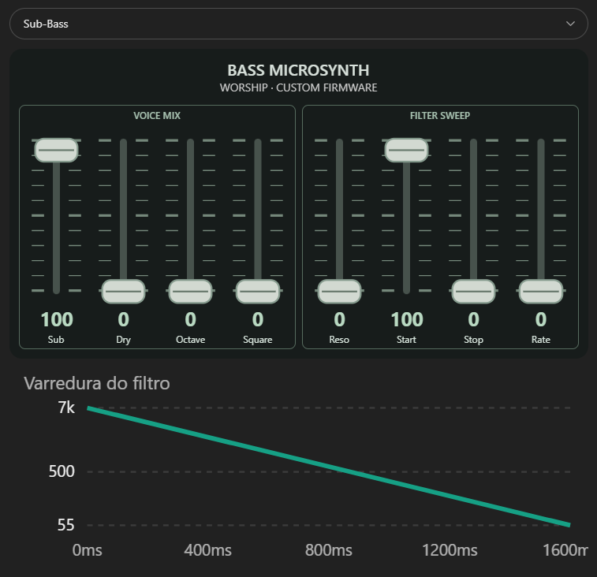
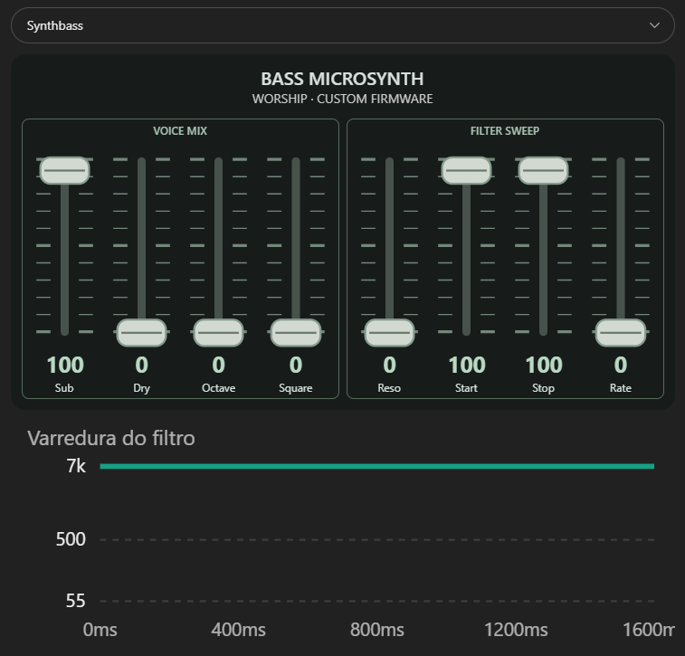
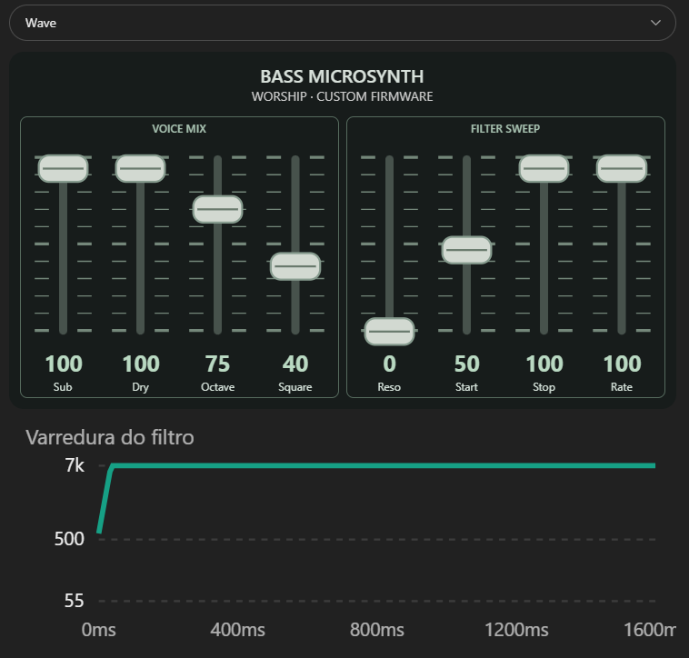

# Pocket Master CFW 1.0.2 — KS Mod (Bass & Synth Edition)

[Português](README.md) | **English** · [Changelog (PT)](CHANGELOG.md) | [Changelog (EN)](CHANGELOG.en.md)

Experimental custom firmware (CFW) modification and Windows desktop editor for the **Sonicake Pocket Master** multi-effects unit, focused on **bass and synth tones**, built on top of **CFW 1.0.2 (base 1.3.3)**.

> [!CAUTION]
> **DISCLAIMER — USE AT YOUR OWN RISK**
>
> This is an experimental third-party modification with no official affiliation with **Sonicake**.
> * **Install and test entirely at your own risk.**
> * Before flashing any `.bin` file to the unit, make a **full backup** of your presets, Impulse Responses (IRs), and Tone Captures/Clones.
> * **We assume no responsibility or liability** for hardware damage, data loss, malfunction, or bricked devices resulting from using this firmware, installer, or instructions.
> * Referenced brand and product names (*Aguilar®, Tone Hammer®, Walrus Audio®, Ages®, Boss®, OC-2®, Roland®, Juno-60®, Electro-Harmonix®, Bass Micro Synthesizer®, Sonicake®*) belong to their respective owners and are mentioned solely as tonal references.

---

## Repository Structure

```text
├── firmware/
│   └── PocketMaster_CFW1.0.2_KS_Mod.bin     # Custom firmware (.bin)
├── apps/
│   └── SonicakeCFW-Setup-1.0.2-KSMod.exe    # Windows editor patched for the added modules
├── presets/
│   ├── Sub-Bass.png                         # MicroSynth preset: Sub-Bass
│   ├── Synthbass.png                        # MicroSynth preset: Synthbass
│   └── Wave.png                             # MicroSynth preset: Wave
├── CHANGELOG.md / CHANGELOG.en.md
├── LICENSE
└── README.md / README.en.md
```

---

## Added Pedals & Amp

On top of the original CFW 1.0.2 effects, **5 bass & synth modules** were added and optimized for low DSP usage across the full signal chain:

| Module | Slot(s) | Tonal Inspiration | Controls |
| :--- | :--- | :--- | :--- |
| **Tone Hammer** | `AMP` | Aguilar® Tone Hammer® Preamp/DI | `Gain`, `Bass`, `Middle`, `MidFreq`, `Treble`, `VOL`, `AGS` (`Off/On`) |
| **Ages OD** | `DRV` | Walrus Audio® Ages® Overdrive | `Volume`, `Dry`, `Gain`, `Bass`, `Treble`, `Mode` (`1–5`) |
| **OC-2 Oct** | `FX1` & `FX2` | Boss® OC-2 Octaver® analog divider | `Oct1` (-1 Oct), `Dry`, `Oct2` (-2 Oct) |
| **J-60 Chorus** | `FX1` & `FX2` | Roland® Juno-60 / June-60 BBD | `I`, `II`, `Mix`, `Tone`, `VOL` |
| **MicroSynth** | `FX2` | EHX® Bass Micro Synthesizer® | `Sub`, `Dry`, `Octave`, `Square`, `Reso`, `Start`, `Stop`, `Rate` |

### Additional Customizations
* **Boot Screen:** custom startup animation (`KS Mod`).
* **Windows Editor (`Sonicake CFW`):** recognizes all 5 added modules, displays proper labels/parameter controls, and loads custom firmware binaries without `"not a published release"` warnings.

---

## Example Presets — MicroSynth

Here are 3 tested presets for the **MicroSynth** (`FX2`) module:

### 1. Sub-Bass
Pure sub-bass tone with a slow downward filter sweep (~7 kHz → ~55 Hz):
* `Sub: 100` | `Dry: 0` | `Octave: 0` | `Square: 0` | `Reso: 0` | `Start: 100` | `Stop: 0` | `Rate: 0`



### 2. Synthbass
Full-bodied sub-octave synth bass with an open static filter (7 kHz):
* `Sub: 100` | `Dry: 0` | `Octave: 0` | `Square: 0` | `Reso: 0` | `Start: 100` | `Stop: 100` | `Rate: 0`



### 3. Wave
Fast upward sweep (~500 Hz → 7 kHz) blending sub-octave, dry signal, octave-up, and square wave:
* `Sub: 100` | `Dry: 100` | `Octave: 75` | `Square: 40` | `Reso: 0` | `Start: 50` | `Stop: 100` | `Rate: 100`



---

## Installation Guide (At Your Own Risk)

### 1. Prerequisites & Backup
1. Connect the Pocket Master to your PC via **USB** and **back up** all presets, IRs, and captures.
2. Make sure the unit's battery is charged or connect directly to a rear motherboard USB port (avoid unstable USB hubs).

### 2. Install the Windows Editor (`Sonicake CFW`)
1. Run [`apps/SonicakeCFW-Setup-1.0.2-KSMod.exe`](apps/SonicakeCFW-Setup-1.0.2-KSMod.exe) to install or update the Windows editor configured for the added modules.

### 3. Flash the Firmware (`.bin`)
* **File:** [`firmware/PocketMaster_CFW1.0.2_KS_Mod.bin`](firmware/PocketMaster_CFW1.0.2_KS_Mod.bin)
* **Size:** `2,125,752` bytes
* **SHA-256:** `2661264CA336ED537DB9F5501EDD99A882BDBC2B23966FD4252C1ECA7186567D`

1. Open **Sonicake CFW**, connect your pedal via USB, and go to the firmware update screen.
2. Select `firmware/PocketMaster_CFW1.0.2_KS_Mod.bin` and confirm the flash.
3. **Do not unplug the USB cable or turn off the unit** until the progress bar completes and the pedal reboots.

> [!NOTE]
> When migrating from stock firmware to the CFW 1.0.2 base for the first time, your IR and Clone slots may be reordered or cleared — always back up beforehand.

---

## Credits & Base Project

This mod is built on top of **Pocket Master Custom Firmware (CFW 1.0.2)** and the **Sonicake CFW** app created by the original CFW developer:

* Official base CFW website: https://pocketmaster-cfw.guitar-training-generator.com/

All credit for the original CFW 1.0.2 architecture, slot unlocking, and base tooling goes to the original creator.

---

## License

Distributed under the terms in [`LICENSE`](LICENSE) (**without warranty** of any kind).
