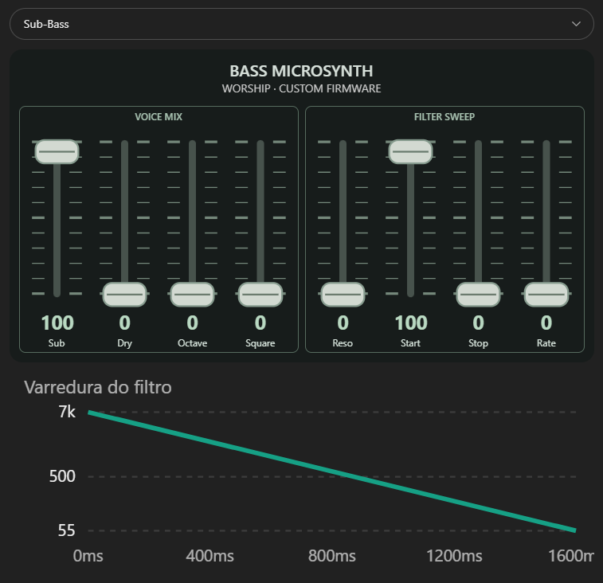
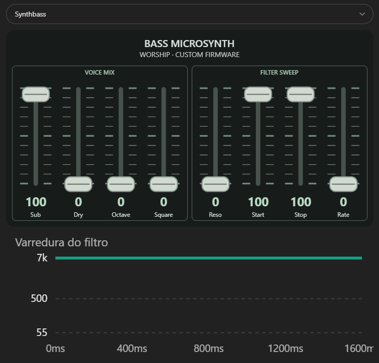
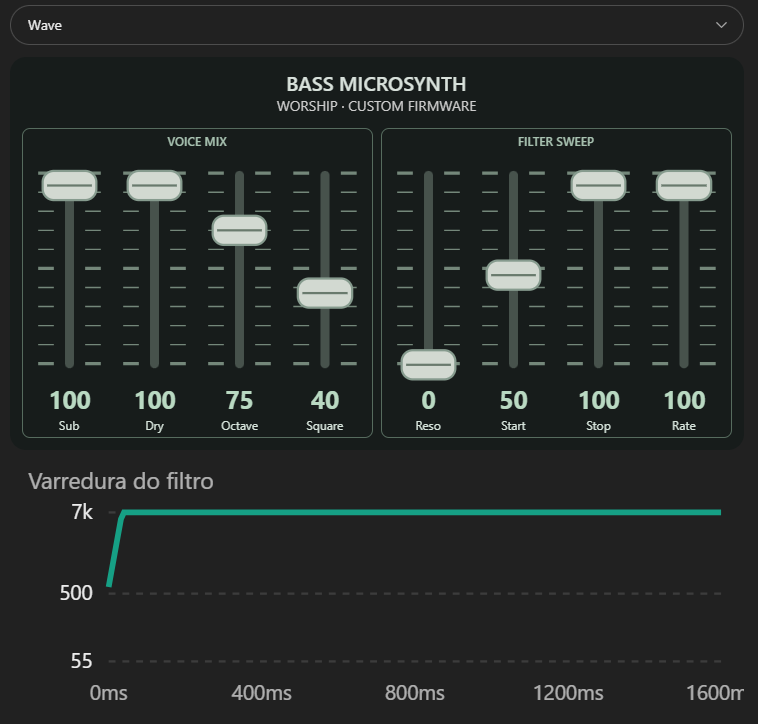

# Pocket Master CFW 1.0.2 — KS Mod (Bass & Synth Edition)

**Português** | [English](README.en.md) · [Changelog](CHANGELOG.md) | [Changelog (EN)](CHANGELOG.en.md)

Modificação experimental de custom firmware (CFW) e editor Windows para a pedaleira **Sonicake Pocket Master**, focada em **contrabaixo e timbres synth**, baseada na **CFW 1.0.2 (base 1.3.3)**.

> [!CAUTION]
> **AVISO LEGAL — USE POR SUA CONTA E RISCO**
>
> Este projeto é uma modificação experimental sem vínculo oficial com a **Sonicake**.
> * **Instale e teste inteiramente por sua própria conta e risco.**
> * Antes de gravar qualquer arquivo `.bin` na pedaleira, faça **backup completo** de seus presets, Impulse Responses (IRs) e capturas/clones.
> * **Não nos responsabilizamos** por eventuais danos ao hardware, perda de dados, mau funcionamento ou inutilização (*brick*) do equipamento decorrentes do uso deste firmware, do instalador ou das instruções aqui descritas.
> * Marcas citadas (*Aguilar®, Tone Hammer®, Walrus Audio®, Ages®, Boss®, OC-2®, Roland®, Juno-60®, Electro-Harmonix®, Bass Micro Synthesizer®, Sonicake®*) pertencem aos seus respectivos proprietários e são usadas apenas como referência sonora de inspiração dos algoritmos.

---

## Estrutura do Repositório

```text
├── firmware/
│   └── PocketMaster_CFW1.0.2_KS_Mod.bin     # Firmware customizado (.bin)
├── apps/
│   └── SonicakeCFW-Setup-1.0.2-KSMod.exe    # Editor Windows compatível com os novos módulos
├── presets/
│   ├── Sub-Bass.png                         # Preset MicroSynth: Sub-Bass
│   ├── Synthbass.png                        # Preset MicroSynth: Synthbass
│   └── Wave.png                             # Preset MicroSynth: Wave
├── CHANGELOG.md
├── LICENSE
└── README.md
```

---

## Pedais e Amplificador Adicionados

Além dos módulos originais da CFW 1.0.2, foram adicionados **5 efeitos voltados para baixo e synth**, com processamento otimizado para uso em cadeia completa na pedaleira:

| Módulo | Slot(s) | Inspiração Sonora | Controles |
| :--- | :--- | :--- | :--- |
| **Tone Hammer** | `AMP` | Aguilar® Tone Hammer® Preamp/DI | `Gain`, `Bass`, `Middle`, `MidFreq`, `Treble`, `VOL`, `AGS` (`Off/On`) |
| **Ages OD** | `DRV` | Walrus Audio® Ages® Overdrive | `Volume`, `Dry`, `Gain`, `Bass`, `Treble`, `Mode` (`1–5`) |
| **OC-2 Oct** | `FX1` e `FX2` | Boss® OC-2 Octaver® analógico | `Oct1` (-1 Oct), `Dry`, `Oct2` (-2 Oct) |
| **J-60 Chorus** | `FX1` e `FX2` | Roland® Juno-60 / June-60 BBD | `I`, `II`, `Mix`, `Tone`, `VOL` |
| **MicroSynth** | `FX2` | EHX® Bass Micro Synthesizer® | `Sub`, `Dry`, `Octave`, `Square`, `Reso`, `Start`, `Stop`, `Rate` |

### Outras Personalizações
* **Tela de Boot:** animação de inicialização personalizada (`KS Mod`).
* **Editor Windows (`Sonicake CFW`):** reconhece todos os 5 módulos adicionados, exibe descrições/parâmetros corretos e carrega o firmware customizado sem alertas de arquivo não publicado.

---

## Presets de Exemplo — MicroSynth

Abaixo estão 3 timbres testados no módulo **MicroSynth** (`FX2`):

### 1. Sub-Bass
Sub-grave puro com varredura descendente longa (~7 kHz → ~55 Hz):
* `Sub: 100` | `Dry: 0` | `Octave: 0` | `Square: 0` | `Reso: 0` | `Start: 100` | `Stop: 0` | `Rate: 0`



### 2. Synthbass
Sub-grave encorpado com filtro aberto contínuo (7 kHz):
* `Sub: 100` | `Dry: 0` | `Octave: 0` | `Square: 0` | `Reso: 0` | `Start: 100` | `Stop: 100` | `Rate: 0`



### 3. Wave
Ataque rápido ascendente (~500 Hz → 7 kHz) misturando sub-oitava, sinal limpo, oitava acima e onda quadrada:
* `Sub: 100` | `Dry: 100` | `Octave: 75` | `Square: 40` | `Reso: 0` | `Start: 50` | `Stop: 100` | `Rate: 100`



---

## Como Instalar (Por Sua Conta e Risco)

### 1. Pré-requisitos e Backup
1. Conecte o Pocket Master ao PC via **USB** e **faça backup** de todos os seus presets, IRs e capturas.
2. Certifique-se de que a bateria da pedaleira esteja carregada ou o cabo USB conectado diretamente em uma porta traseira do computador.

### 2. Instalar o Editor Windows (`Sonicake CFW`)
1. Execute [`apps/SonicakeCFW-Setup-1.0.2-KSMod.exe`](apps/SonicakeCFW-Setup-1.0.2-KSMod.exe) para instalar/atualizar o editor Windows já configurado para os novos módulos.

### 3. Gravar o Firmware (`.bin`)
* **Arquivo:** [`firmware/PocketMaster_CFW1.0.2_KS_Mod.bin`](firmware/PocketMaster_CFW1.0.2_KS_Mod.bin)
* **Tamanho:** `2.125.752` bytes
* **SHA-256:** `2661264CA336ED537DB9F5501EDD99A882BDBC2B23966FD4252C1ECA7186567D`

1. Abra o **Sonicake CFW**, conecte a pedaleira via USB e acesse a tela de atualização de firmware.
2. Selecione `firmware/PocketMaster_CFW1.0.2_KS_Mod.bin` e confirme a gravação.
3. **Não desconecte o cabo nem desligue o pedal** até a barra concluir e o equipamento reiniciar completamente.

> [!NOTE]
> Se estiver migrando do firmware oficial (*stock*) para a base CFW 1.0.2 pela primeira vez, seus slots de IR e Clones podem ser reordenados ou limpos — por isso o backup prévio é indispensável.

---

## Créditos e Base do Projeto

Este mod foi construído sobre a **Pocket Master Custom Firmware (CFW 1.0.2)** e o aplicativo **Sonicake CFW**, projetos desenvolvidos pelo autor original da CFW:

* Site oficial da CFW base: https://pocketmaster-cfw.guitar-training-generator.com/

Todos os créditos pelo desenvolvimento inicial da CFW 1.0.2, desbloqueio de slots e ferramentas base pertencem ao criador original.

---

## Licença

Distribuído sob os termos da licença em [`LICENSE`](LICENSE) (**sem garantias** de qualquer tipo).
